# Computer network concepts for this project

**Project:** Explainable AI-Based Dynamic Routing Recommendation System  
**Scope:** Concepts you need for Title 4 (Layer 3 path choice, QoS, RIP/OSPF, graphs, XAI). This is not a full CN textbook (no CRC, Hamming, subnetting drills).  
**Code topology:** `projects/xai-dynamic-routing/data/samples/sample_topology.json` (R1–R8).

Figures live in `docs/concepts/figures/`. Flowcharts below render in GitHub / VS Code Markdown preview.

---

## How to read this document

Each concept uses the same shape: **definition → layer → how it works → example → use in this project → flowchart or figure.**

---

## 1. What a computer network is

**Definition.** A computer network is a set of **nodes** (hosts, routers, switches) connected by **links** so they can exchange **packets**.

**Layer.** The whole stack (OSI / TCP/IP). This project lives mainly at **Layer 3**.

**How it works.** An application on a host hands data to transport (TCP/UDP), which hands segments to IP. IP routers forward packets toward the destination. The **path** is the sequence of routers a packet visits.

**Example.** Phone A talks to server B. Packets leave A, hit campus routers, then ISP routers, then B’s data center.

**Use case here.** We model routers as graph nodes `R1`…`R8` and links as weighted edges (delay, bandwidth, risk, …). We do **not** run a live campus IGP.

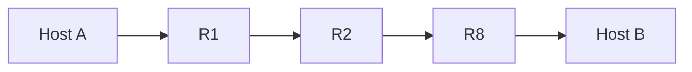

---

## 2. OSI vs TCP/IP — where routing sits

**Definition.** **OSI** is a 7-layer teaching model. **TCP/IP** is the 4-layer Internet model. **Routing** is deciding the next hop / path at the **network (OSI) / internet (TCP/IP)** layer.

**How it works.** Switches forward on MAC (L2). Routers forward on IP (L3). TCP (L4) cares about ports and reliability, not which core path OSPF picked.

**Example.** A browser uses HTTP (application) over TCP (transport) over IP (internet). The **route** between campus and cloud is an L3 decision.

**Use case here.** RIP, OSPF, and the AI recommender all produce **L3 paths**. SHAP/LIME explain that path choice; they are not a new OSI layer.

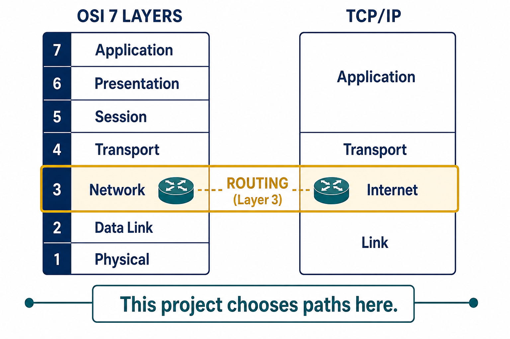

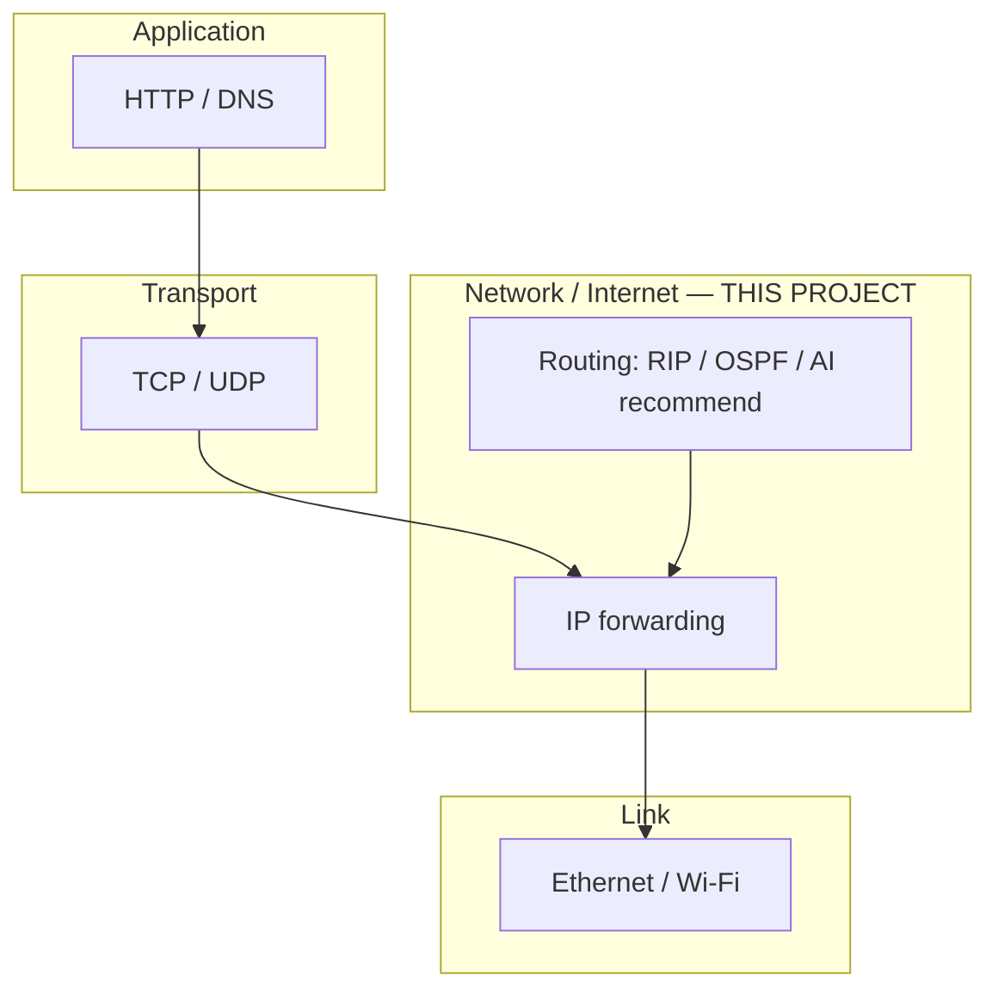

---

## 3. Packet, encapsulation, hop-by-hop forwarding

**Definition.** A **packet** is IP header + payload. **Encapsulation** wraps data with headers as it goes down the stack. **Forwarding** is: look at destination IP, consult a table, send the packet out one interface (**next hop**).

**How it works.** The **end-to-end path** is many next-hop choices. Each router only needs the next hop, not the full path, once a routing protocol (or an operator/AI) has filled the forwarding table.

**Example.** Path `R1 → R2 → R4 → R8`. At R1 the next hop toward R8 is R2. At R2 it is R4. At R4 it is R8.

**Use case here.** The AI **recommends** a full path (or a preferred next hop). Real forwarding would still be hop by hop. We simulate the path as a sequence of edges.

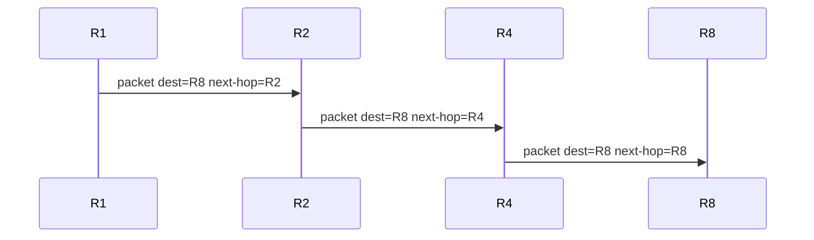

---

## 4. Topology as a graph

**Definition.** A **topology** is who is connected to whom. In math: undirected (or directed) **graph** `G = (V, E)`. Routers = vertices. Links = edges with **attributes**.

**Layer.** Logical map of L3 (and sometimes L2) connectivity.

**How it works.** Algorithms (Dijkstra, k-shortest paths) run on this graph. If a link fails, that edge is removed or given infinite cost.

**Example.** Our sample graph has 8 nodes and 11 edges. Source **R1**, destination **R8**.

**Use case here.** Phase 0 loads this JSON into NetworkX. All later phases read those edge attributes.

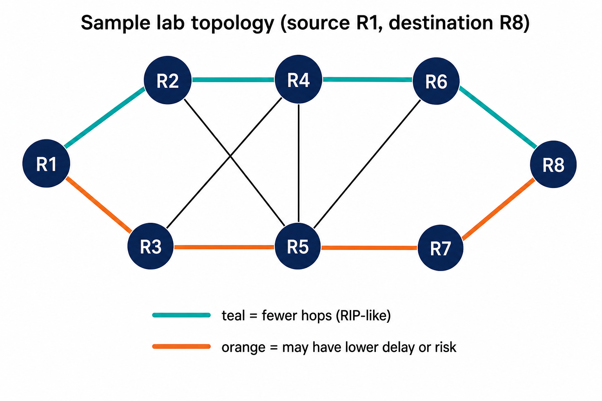

**Mini example (two paths R1→R8):**

| Path | Hops | Idea |
|------|------|------|
| R1–R2–R4–R6–R8 | 4 | Often fewer hops (RIP-like) |
| R1–R3–R5–R7–R8 | 4 | Same hop count; **metrics** on edges decide OSPF/AI |

Exact hop counts depend on the edges; RIP always minimizes **number of links**, OSPF minimizes **sum of costs**.

---

## 5. Path, hop count, and cost

**Definition.** A **path** is a simple walk from source `s` to destination `t` with no repeated vertices (in our labs). **Hop count** = number of edges on the path. **Cost** = sum of per-link costs (delay, or `10^8 / bandwidth`, etc.).

**How it works.**

- RIP-like: cost of every link = 1 → shortest path = fewest hops.  
- OSPF-like: cost is configured (Cisco often `reference_bw / interface_bw`). We use delay or `10^8/bandwidth`.

**Example.** Path with 3 links of delay 5, 8, 5 ms → hop count 3, OSPF-style delay cost 18.

**Use case here.** Baselines (Phase 2) print both. AI (Phase 3) uses a **vector of features**, not a single cost.

**Final answers (pattern):**

- RIP: **path P with minimum hops**  
- OSPF: **path P with minimum sum of link costs**

---

## 6. Quality of Service (QoS) metrics

**Definition.** **QoS** is how well the network serves traffic: delay, loss, jitter, throughput, not only “is it connected?”

**Layer.** Measured on links/queues (L2/L3) and observed end-to-end (L3/L4).

| Metric | Meaning | Typical unit | Better when |
|--------|---------|--------------|-------------|
| Delay / latency | Time to cross a link or path | ms | Lower |
| Bandwidth | Capacity of a link | Mbps | Higher |
| Available bandwidth | Capacity minus load | Mbps | Higher |
| Utilization | Load / capacity | 0–1 | Not too close to 1 |
| Congestion | Queues building, high util | 0–1 | Lower |
| Packet loss | Fraction dropped | 0–1 | Lower |
| Queue length | Packets waiting | packets | Lower |
| Jitter | Delay variation | ms | Lower (not in v1 sample JSON) |
| Energy | Cost of using a node/link | arbitrary | Lower (green routing) |
| Reliability | Chance link stays up | 0–1 | Higher |
| Security risk | Lab score of “how risky this link is” | 0–1 | Lower |

**Example.** A 100 Mbps link carrying 80 Mbps has utilization 0.8; queues and delay grow if it sits near 1.0.

**Use case here.** Sample edges store delay, bandwidth, congestion, loss, energy, `security_risk`, utilization, queue, reliability. Phase 1 **aggregates** them along a candidate path (sum delay, min bandwidth, max risk, …).

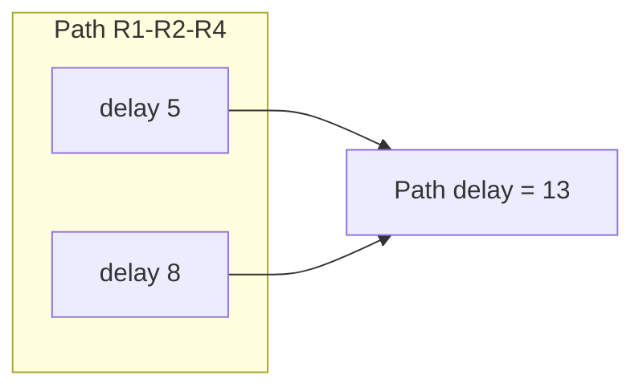

**Security risk (this course).** It is a **number on the link**, like congestion. It is **not** an attack tutorial. A high score means “prefer another path in the simulation.”

---

## 7. Static vs dynamic routing

**Definition.** **Static** routes are typed by an admin and stay until changed. **Dynamic** routing protocols (RIP, OSPF, BGP) **exchange messages** and recompute when topology or (sometimes) metrics change.

**How it works.** Hello/LSA/advertisements → each router updates a map or distance table → SPF or Bellman-Ford → install next hops.

**Example.** Link R2–R5 becomes congested. A **dynamic** recommender (Phase 6) should pick a different path at the next time step. RIP/OSPF in real life also reconverge on **failures**; classic RIP/OSPF do **not** jointly optimize delay+risk+energy the way this project does.

**Use case here.** Title says *dynamic*. v1 (through M3) can still be **one snapshot**. Phase 6 changes metrics over time and **reroutes**.

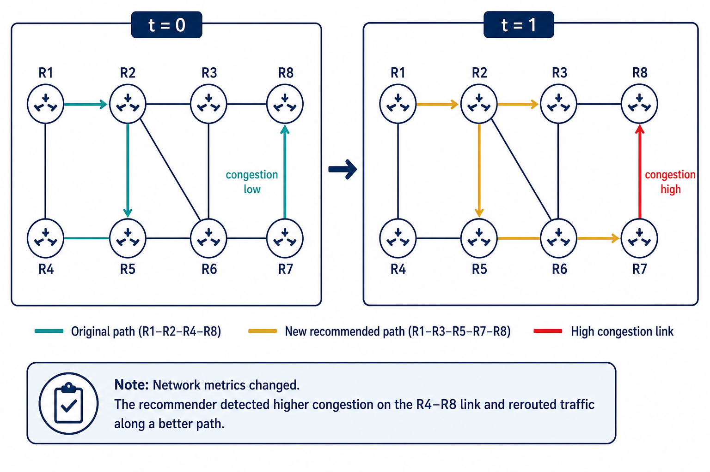

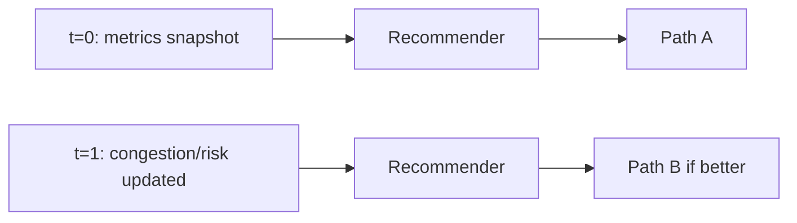

---

## 8. RIP (Routing Information Protocol) — hop count

**Definition.** RIP is a **distance-vector** IGP. The metric is **hop count** (max 15 hops in RIP). Neighbors advertise “I can reach X in n hops.”

**Layer.** L3 intra-domain (small networks historically).

**How it works (idea).** Bellman-Ford style: for each destination, pick neighbor with smallest advertised hop count + 1. Slow convergence and count-to-infinity are textbook issues; we **do not** implement full RIP messages in Phase 2 — we implement **RIP-like**: Dijkstra with unit weights (equivalent to fewest hops on an undirected graph).

**Example.** From R1 to R8, any path with 4 edges beats a path with 5, even if the 4-edge path is slower in milliseconds.

**Use case here.** Baseline #1. Compare hop count against OSPF delay and against AI.

**Use case in industry.** Small/legacy LANs; mostly replaced by OSPF/EIGRP/IS-IS in serious campuses.

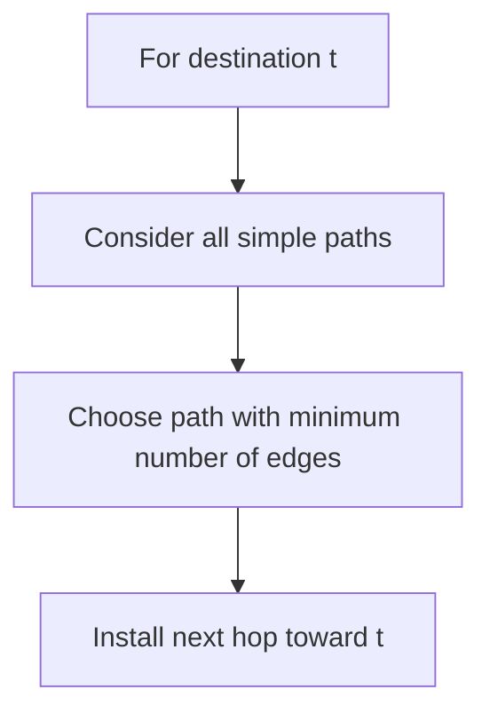

---

## 9. OSPF (Open Shortest Path First) — link cost + Dijkstra

**Definition.** OSPF is a **link-state** IGP. Each router floods **LSAs** so everyone has the same topology. Each router runs **SPF (Dijkstra)** from itself as source.

**Layer.** L3 intra-domain (enterprise, ISP IGP).

**How it works.**

1. Discover neighbors (Hello).  
2. Flood link-state (who I connect to, cost).  
3. Build shortest-path tree with Dijkstra.  
4. Install next hops in the FIB.

**Cost.** Not hop count. Often inverse bandwidth. In this project: **`ospf_cost`: `delay`** in `configs/default.json`, or `10^8 / bandwidth`.

**Example (tiny).** Nodes A–B cost 10, A–C cost 2, C–B cost 2. OSPF A→B is A–C–B (cost 4), not A–B (cost 10), even if RIP would like A–B (1 hop).

**Use case here.** Baseline #2: NetworkX `shortest_path` with weight = delay (or bandwidth cost).

**Use case in industry.** Default campus/core IGP.

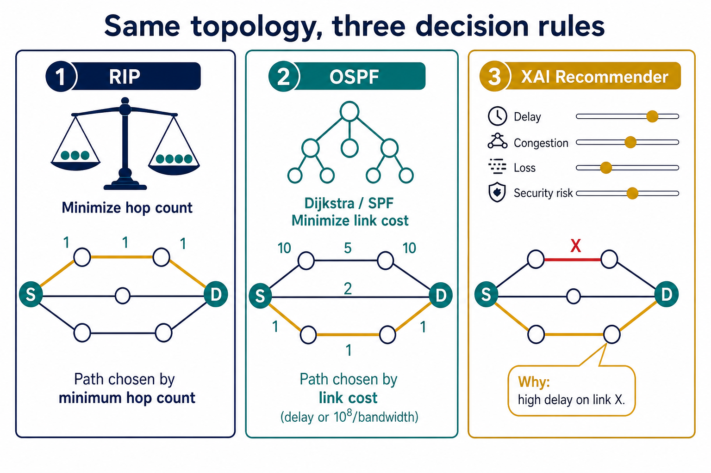

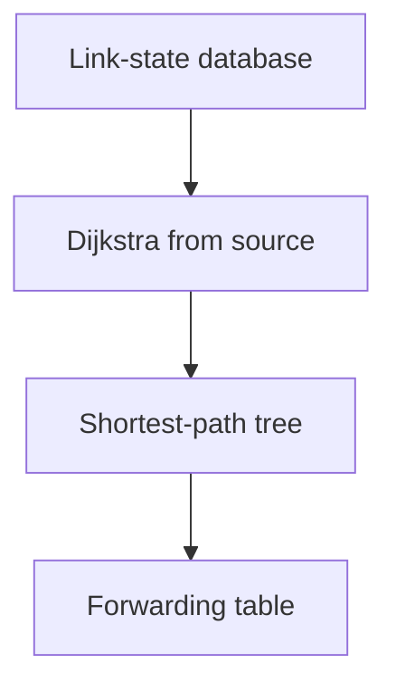

---

## 10. Dijkstra’s algorithm (SPF)

**Definition.** Finds least-cost paths from one source to all nodes when **edge weights are non-negative**.

**Layer.** Algorithm used by OSPF/IS-IS at L3; also used in maps.

**How it works (lab trace).**

1. Distance to source = 0; others = ∞.  
2. Repeat: pick unvisited node `u` with smallest distance.  
3. Relax each neighbor `v`: if `dist(u) + w(u,v) < dist(v)`, update `dist(v)` and previous hop.

**Worked example.**

Graph: `S-A` weight 4, `S-B` weight 1, `B-A` weight 1, `A-T` weight 1, `B-T` weight 5. Source S, target T.

| Step | Visit | dist A | dist B | dist T | Previous |
|------|--------|--------|--------|--------|----------|
| 0 | — | ∞ | ∞ | ∞ | — |
| 1 | S | 4 | 1 | ∞ | S→A, S→B |
| 2 | B | 2 | 1 | 6 | B→A (2), B→T (6) |
| 3 | A | 2 | 1 | 3 | A→T (3) |
| 4 | T | 2 | 1 | 3 | done |

**Final:** path **S → B → A → T**, cost **3**.

**Use case here.** OSPF-like baseline; k-shortest paths are “Dijkstra + hide edges / Yen.”

---

## 11. Why “shortest” is not always “best”

**Definition.** Shortest-path = minimum of **one** scalar. **Best** for a user/operator may mix delay, loss, risk, energy.

**Example.** 1-hop satellite link: hop count 1 but delay 600 ms. 3-hop fibre: delay 15 ms. RIP prefers satellite; a QoS-aware system prefers fibre.

**Use case here.** The **research gap**: OSPF/RIP cannot jointly use delay + congestion + loss + energy + **security risk**, and they do not **explain** a learned choice.

---

## 12. Candidate paths and path features (Phase 1)

**Definition.** **k-shortest paths** (or hop-capped search) lists several routes from `s` to `t`. Each path becomes a **feature vector**.

**How it works.** Example aggregates (document the exact names in code when P1 lands):

- `hops`  
- `sum_delay`, `max_delay`  
- `min_bandwidth`  
- `max_security_risk`  
- `mean_congestion`  
- `sum_loss` or `max_loss`  
- `mean_energy`  
- `max_utilization`, `max_queue`  
- `min_reliability`

**Example.** Path P: delays 5+8+5, risks 0.1, 0.2, 0.1 → `sum_delay=18`, `max_security_risk=0.2`, `hops=3`.

**Use case here.** Training table: many `(s, t, path)` rows. Label = score from a weighted formula (Phase 3), not from CAIDA at first.

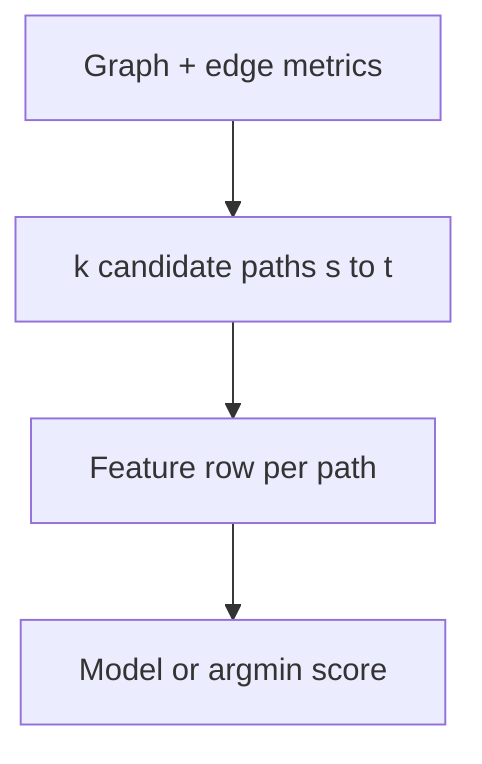

---

## 13. Multi-criteria score (labels for AI)

**Definition.** Combine metrics into one **score** (lower better or higher better — pick one and stick to it).

**Example (illustrative, not the only formula):**

`score = w1 * sum_delay + w2 * max_risk + w3 * mean_congestion + w4 * hops`

with positive weights. The **label** for supervised learning is this score, or “which of k paths has the best score.”

**Use case here.** Phase 3 Random Forest learns to predict score / pick the winner from features. RIP/OSPF are **not** required as labels (phase plan).

---

## 14. Explainable AI (SHAP and LIME) on routing

**Definition.** **XAI** explains a model’s output. **SHAP** assigns each feature a contribution (Shapley-style) to the prediction. **LIME** fits a simple local model around one instance.

**Layer.** Not an OSI layer. It sits **on top of** the recommender.

**How it works for us.**

1. Model outputs a score or “choose path P.”  
2. SHAP: “`max_security_risk` added +0.22 to the score; `sum_delay` added +0.41.”  
3. Operator reads that like a lab trace.

**Example.** “Path via R2–R5 rejected: `security_risk` 0.7 and congestion 0.8 dominate.”

**Use case here.** Title requirement: every recommendation is **auditable**. SHAP/LIME do **not** replace OSPF in a real kernel; they justify the **AI** choice.

**Use case in ops.** Trust, debugging, viva: “why not the RIP path?”

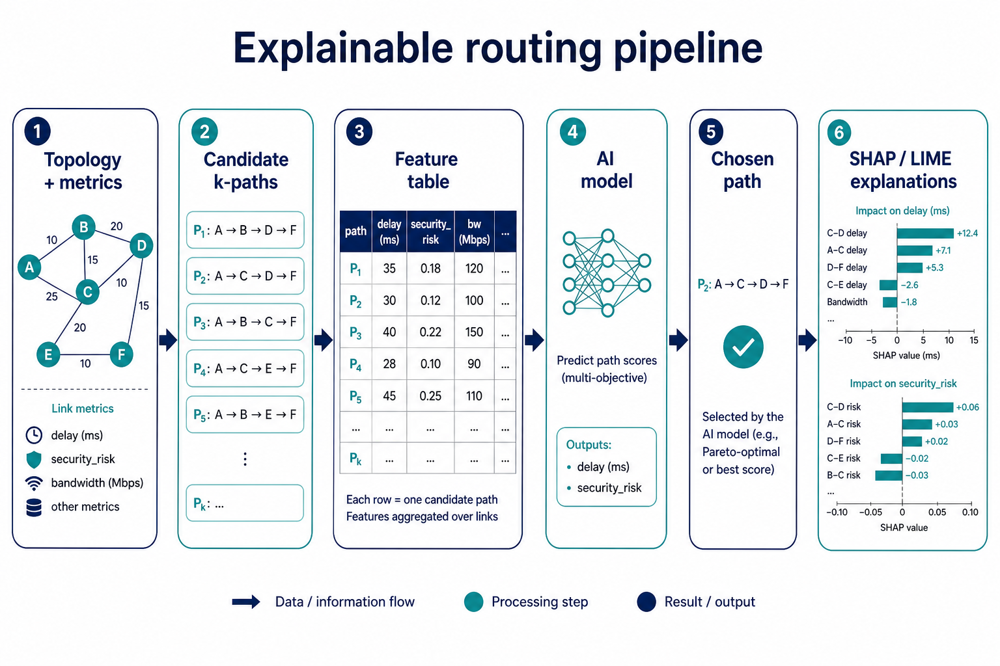

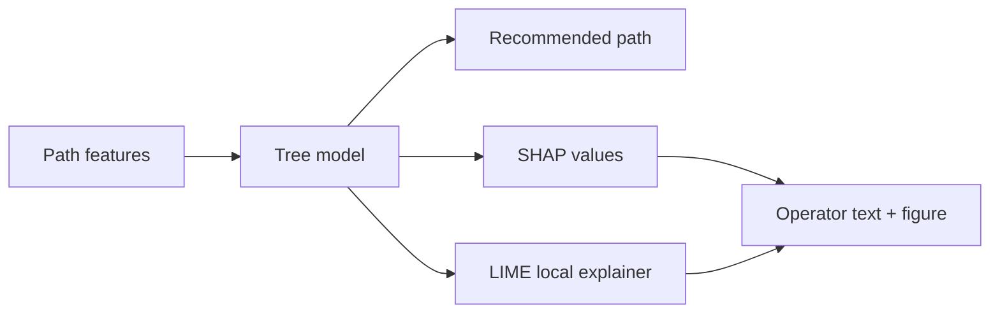

---

## 15. Comparing RIP, OSPF, and AI (Phase 5)

**Definition.** **Evaluation** = same `s`, `t`, same graph snapshot; three paths; same metrics computed on each path.

**Example table (shape):**

| Method | Path | Hops | Sum delay | Max risk | Loss |
|--------|------|------|-----------|----------|------|
| RIP | … | | | | |
| OSPF | … | | | | |
| AI | … | | | | |
| AI why | top SHAP features | | | | |

**Use case here.** Report figures. Overview also mentions a non-explained AI baseline (fault **F-009** — not changed until you approve).

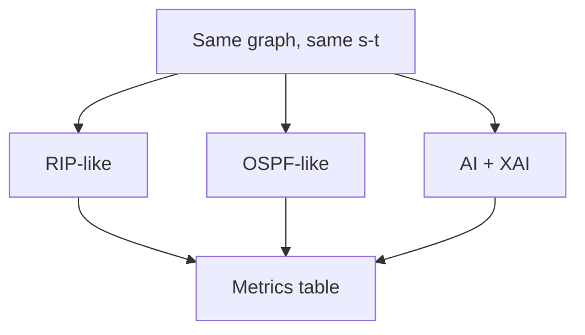

---

## 16. Simulation vs real protocols

**Definition.** **Simulation** (NetworkX, later Mininet/NS-3) approximates behavior. Real RIP/OSPF use timers, flooding, areas, authentication.

**Use case here.** Phases 0–6: Python graph. Phase 7 optional: Topology Zoo / Mininet. We **do not** replace production OSPF on live gear (overview §11).

**Datasets (later):** Topology Zoo (real maps), SNDlib (traffic instances), CAIDA (traffic stats — gitignore dumps).

---

## 17. Control plane vs data plane (short)

**Definition.** **Data plane:** forwarding packets. **Control plane:** computing routes (RIP/OSPF/AI).

**Example.** OSPF SPF is control plane; switching a packet onto an outgoing interface is data plane.

**Use case here.** Recommender = extra **control-plane** advisor. Data plane in the lab is “walk the chosen path in the graph.”

---

## 18. End-to-end project flow

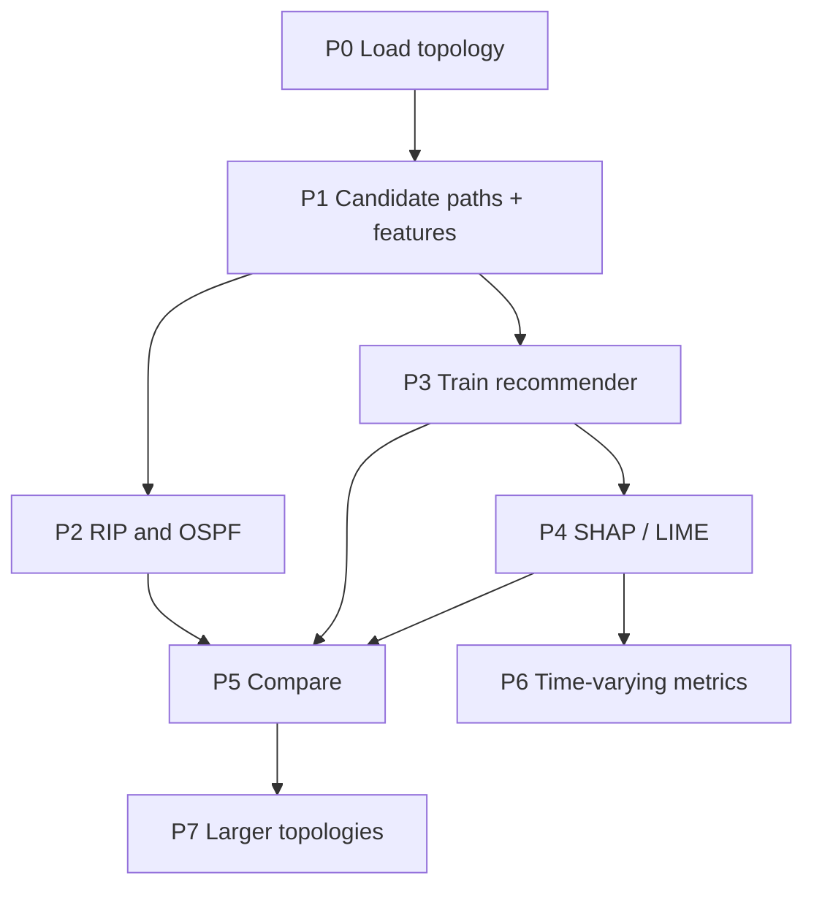

**Network idea (one sentence).** Packets still move hop by hop; this project **chooses which path** using QoS + security features and **shows why**.

---

## 19. Concept checklist (viva)

- [ ] Routing is L3; TCP is L4  
- [ ] Hop count vs additive delay cost  
- [ ] RIP-like = fewest hops; OSPF-like = Dijkstra on link cost  
- [ ] QoS metrics on links and how they aggregate on a path  
- [ ] `security_risk` is a lab attribute, not an exploit  
- [ ] Dynamic = recompute when metrics change  
- [ ] SHAP/LIME explain the model, they are not the IGP  
- [ ] Evaluation compares paths on the **same** snapshot  

---

## 20. Where this lives in the repo

| Resource | Path |
|----------|------|
| This guide | `docs/concepts/cn-concepts-xai-routing.md` |
| Figures | `docs/concepts/figures/` |
| Overview | `docs/xai-dynamic-routing-overview.md` |
| Sample graph | `projects/xai-dynamic-routing/data/samples/sample_topology.json` |
| Run P0 | `docs/execution-plan.md` |
