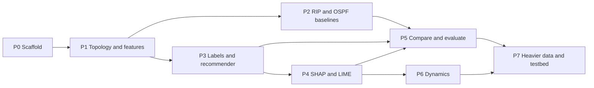

# Phase plan and dependencies

**Project:** Explainable AI-Based Dynamic Routing Recommendation System  
**Code:** `projects/xai-dynamic-routing/`  
**Overview:** [xai-dynamic-routing-overview.md](xai-dynamic-routing-overview.md)

Security risk is a numeric link attribute (0–1). No exploit or attack-procedure work.

**Last updated:** see [phase-execution-status.md](phase-execution-status.md) (refresh that board before each commit).

Tick items when they are true in the repo. Do not start a later **critical-path** phase until the previous phase checklist is complete. P2 may start after P1 even if P3 is unfinished.

---

## 1. Phase graph



**Critical path (first working system):** P0 → P1 → P3 → P4 → P5.

P2 can start as soon as P1 exists; it does **not** wait for the ML model. P6 needs P4 (new explanation each reroute). P7 is last.

| Milestone | After | Meaning | Done |
|-----------|--------|---------|------|
| M0 | P0 | Sample graph loads | [x] |
| M1 | P1 | Candidate paths + feature table | [ ] |
| M2 | P2 | RIP path ≠ OSPF path on sample topo | [ ] |
| **M3 (demo)** | **P4** | AI path + SHAP/LIME text and figure | [ ] |
| M4 | P5 | RIP vs OSPF vs AI comparison table | [ ] |
| M5 | P6–P7 | Time-varying routes and/or Topology Zoo | [ ] |

---

## 2. Status

Canonical snapshot: [phase-execution-status.md](phase-execution-status.md). Do not let this table lag that board.

| Phase | Status | Effort | Checklist |
|-------|--------|--------|-----------|
| 0 Scaffold | **Done** | — | complete |
| 1 Topology + features | Not started | 1–2 days | open |
| 2 Classical baselines | Not started | 1–2 days | open |
| 3 Labels + recommender | Not started | 2–3 days | open |
| 4 XAI | Not started | 2–3 days | open |
| 5 Compare | Not started | 1–2 days | open |
| 6 Dynamics | Optional | ~2 days | open |
| 7 Datasets / Mininet | Later | as needed | open |

### Standing rules (every phase)

- [x] Bind any local service to `127.0.0.1` (`configs/default.json`)
- [x] Treat `security_risk` as a number on the link, not as an attack to implement
- [ ] Print lab-style traces (path, costs, top features) on CLI
- [ ] Do not commit `data/raw/` dumps, large CAIDA files, or bulky `models/` weights

---

## 3. Phase details, dependencies, and checklists

### Phase 0 — Scaffold

| | |
|--|--|
| **Depends on** | Repo + Title 4 brief |
| **Produces** | Folder tree, `requirements.txt`, `configs/default.json`, `data/samples/sample_topology.json`, `src/topology/load.py` |
| **Python** | `networkx` |
| **Blocks** | Everything else |

**Checklist**

- [x] `projects/xai-dynamic-routing/` matches overview section 12
- [x] `requirements.txt` lists networkx, pandas, numpy, scikit-learn, shap, lime, matplotlib
- [x] Sample topology JSON exists (8 nodes, QoS + `security_risk` on edges)
- [x] `load_graph` returns a NetworkX graph
- [x] Project README documents setup, run, and bind address
- [x] `.gitignore` covers `data/raw`, `models`, generated `outputs`

**Exit:** `python -c "from src.topology.load import load_graph; G = load_graph('data/samples/sample_topology.json'); print(G.number_of_nodes(), G.number_of_edges())"` prints `8 11`.

---

### Phase 1 — Topology + features

| | |
|--|--|
| **Depends on** | P0: `load_graph`, edge attributes on the sample JSON |
| **Produces** | `src/features/path_features.py` — k-candidate paths; hop count, sum/max delay, min bandwidth, max `security_risk`, mean congestion, etc. |
| **Python** | `networkx`, `pandas`, `numpy` |
| **Blocks** | P2, P3 (and thus P4–P5) |

**Checklist**

- [ ] Read `k_candidate_paths` and `max_hops` from `configs/default.json`
- [ ] Enumerate k candidate paths (Yen or hop-capped search)
- [ ] Path features include: hops, sum/max delay, min bandwidth, max `security_risk`, mean congestion, sum/max loss, mean energy, max utilization, max queue, min reliability
- [ ] Invalid `src`/`dst` (missing node or no path) fails with a clear message
- [ ] CLI or script prints a table of paths and feature vectors
- [ ] Feature column names are documented (P4/P5 must reuse them)

**Exit:** given `R1` → `R8`, a table of candidate paths and numeric features prints.

---

### Phase 2 — RIP / OSPF baselines

| | |
|--|--|
| **Depends on** | P1 graph + edge costs (`delay`, `bandwidth`) |
| **Does not depend on** | ML model or SHAP |
| **Produces** | `src/routing/baselines.py` — hop-count SPF (RIP-like); Dijkstra on delay or `10^8/bandwidth` (OSPF-like) |
| **Python** | `networkx` |
| **Blocks** | P5 comparison columns for RIP/OSPF |

**Checklist**

- [ ] RIP-like: Dijkstra with unit hop cost; print path and hop count
- [ ] OSPF-like: Dijkstra on `delay` (or `10^8/bandwidth` via config `ospf_cost`)
- [ ] Print chosen path and total cost (lab-style)
- [ ] Same `src`/`dst` can yield different RIP vs OSPF paths on the sample graph
- [ ] Disconnected pair reports no path

**Exit:** `R1` → `R8` shows two traces; paths differ at least once on the sample topology.

---

### Phase 3 — Labels + recommender

| | |
|--|--|
| **Depends on** | P1 feature table; a **label rule** (weighted QoS + security score, or argmin among k paths) |
| **Does not depend on** | P2 (baselines are for comparison, not for training labels unless you choose that) |
| **Produces** | `src/routing/recommender.py`, `scripts/train.py`, `scripts/infer.py`, weights in `models/` |
| **Python** | `scikit-learn` (Random Forest first); optional `xgboost` later |
| **Blocks** | P4, P5 (AI column), P6 |

**Checklist**

- [ ] Document the scalar score (weights for delay, loss, congestion, `security_risk`, …)
- [ ] Build a labeled table: each candidate path → score (or best-of-k class)
- [ ] Train Random Forest (sklearn) on path features; skip RL
- [ ] `scripts/train.py` writes a model under `models/`
- [ ] `scripts/infer.py` prints recommended path for `src` `dst`
- [ ] Held-out pairs: model picks a better-scoring path than hop-count more often than chance
- [ ] Recommended routes written to `outputs/routes/`

**Exit:** infer on `R1` `R8` prints a path; a model file exists; routes dump exists.

---

### Phase 4 — XAI

| | |
|--|--|
| **Depends on** | P3 fitted tree/linear model; P1 **same feature names** as training |
| **Produces** | `src/xai/explain.py`; SHAP (TreeExplainer) + LIME; files in `outputs/explanations/` and `outputs/figures/` |
| **Python** | `shap`, `lime`, `matplotlib` |
| **Blocks** | P5 explanation row; P6 per-step reason |

**Checklist**

- [ ] SHAP TreeExplainer (or KernelExplainer if not a tree) on the trained model
- [ ] LIME on the same instance (one path or one src–dst)
- [ ] Print: path chosen; top features with signed importance (e.g. delay, `security_risk`)
- [ ] Feature names in explanations match P1 columns
- [ ] Save text/JSON under `outputs/explanations/`
- [ ] Save at least one SHAP or LIME figure under `outputs/figures/`
- [ ] `scripts/infer.py` (or a flag) prints explanation with the path

**Exit:** one recommendation includes a human-readable feature list plus a saved figure. **M3.**

---

### Phase 5 — Compare and evaluate

| | |
|--|--|
| **Depends on** | P2 + P3 + P4 (all three columns) |
| **Produces** | `src/evaluate/compare.py`, `scripts/compare.py` — delay, loss, max risk, hops |
| **Python** | `pandas`, `matplotlib` |
| **Blocks** | Report tables; P7 “vs classical IGP” story |

**Checklist**

- [ ] Same `src`/`dst` (and same graph) for RIP, OSPF-like, and AI
- [ ] Metrics: path delay, loss (sum or max), max `security_risk`, hop count
- [ ] Include a short explanation snippet for the AI row
- [ ] `scripts/compare.py` writes CSV and/or markdown
- [ ] At least one comparison figure in `outputs/figures/`
- [ ] Run on several pairs, not only `R1`–`R8`

**Exit:** table RIP vs OSPF vs AI is reproducible from one command. **M4.**

---

### Phase 6 — Dynamics (optional)

| | |
|--|--|
| **Depends on** | P3 + P4; `src/simulate/graph_sim.py` to mutate congestion/loss/risk over time |
| **Produces** | Time-step loop; path change + new SHAP each step |
| **Blocks** | “Dynamic” claim in the title |

**Checklist**

- [ ] Each step updates at least congestion, loss, or `security_risk` on some edges
- [ ] Re-run recommender every step
- [ ] Print path; if it changes, print old vs new
- [ ] New SHAP/LIME reason printed on change (and optionally every step)
- [ ] 10-step run on sample topology
- [ ] At least one reroute occurs in the canned scenario

**Exit:** 10-step log with ≥1 reroute and a printed reason.

---

### Phase 7 — Heavier data / testbed (later)

| | |
|--|--|
| **Depends on** | P5 (evaluation harness); optionally P6 |
| **Produces** | Topology Zoo GML loader; SNDlib-like demand; Mininet/Packet Tracer only after the Python demo works |
| **External data** | Topology Zoo, SNDlib, CAIDA (large → `data/raw/`, gitignored) |

**Checklist**

- [ ] M3 demo works on the sample graph first
- [ ] Loader for Topology Zoo GML (or one exported topology)
- [ ] Map or fill missing metrics (delay, risk) with documented defaults
- [ ] `compare.py` runs on that topology
- [ ] CAIDA/SNDlib files stay in `data/raw/` and are gitignored
- [ ] Mininet / Packet Tracer only if a live demo is still required (bind `127.0.0.1`)

**Exit:** one non-toy topology produces a comparison table.

---

## 4. What can run in parallel

| Track A | Track B | Merge at |
|---------|---------|----------|
| P2 baselines | P3 train/infer | P5 |
| Report text (problem, gap) from overview | Coding P1–P4 | P5 figures |

Do **not** start P4 before P3. Do **not** start Mininet before M3.

---

## 5. File dependency order

```
src/topology/load.py                          [P0, exists]
        ↓
src/features/path_features.py                 [P1]
        ↓
        ├─→ src/routing/baselines.py          [P2]
        └─→ src/routing/recommender.py        [P3]
                    ↓
            src/xai/explain.py                [P4]
                    ↓
        src/evaluate/compare.py               [P5]  ← also needs baselines
                    ↓
        src/simulate/graph_sim.py             [P6]

scripts/train.py  → P3
scripts/infer.py  → P3, P4
scripts/compare.py → P5
```

---

## 6. Python / tool dependencies

| Package | First needed | Role |
|---------|----------------|------|
| `networkx` | P0 | Graph, Dijkstra, k-paths |
| `numpy`, `pandas` | P1 | Feature tables |
| `scikit-learn` | P3 | Random Forest / metrics |
| `shap` | P4 | Global/local feature attributions |
| `lime` | P4 | Local surrogate explanation |
| `matplotlib` | P4 | Explanation and compare plots |
| `xgboost` | Optional P3 | Stronger tree model + TreeSHAP |
| NS-3 / Mininet / Packet Tracer | P7 only | Optional live demo |

Install from `projects/xai-dynamic-routing/requirements.txt`. Bind any later UI to `127.0.0.1` (`configs/default.json`).

---

## 7. Data dependencies

| Data | Phase | Notes |
|------|--------|--------|
| `data/samples/sample_topology.json` | P0–P6 | 8 nodes, 11 edges; enough for M3 |
| Synthetic labels from score function | P3 | No CAIDA required to train v1 |
| Topology Zoo GML | P7 | Real topologies |
| SNDlib | P7 | Traffic instances |
| CAIDA | P7 | Traffic stats; do not commit dumps |

---

## 8. Implementation order (next)

1. **P1** — `path_features.py` + small CLI to print the feature table  
2. **P2** — `baselines.py` (can overlap late P1)  
3. **P3** — score labels + Random Forest + `train.py` / `infer.py`  
4. **P4** — SHAP then LIME  
5. **P5** — `compare.py`  
6. P6 then P7 if time remains

When a phase is finished: tick its checklist, set Status to Done, and tick the matching milestone in section 1.
